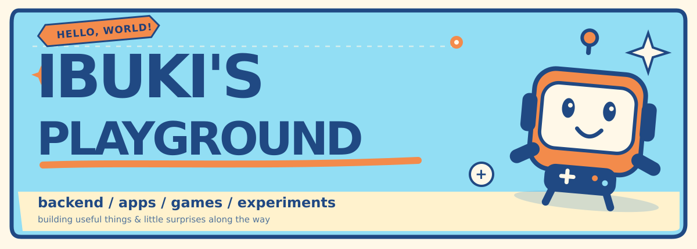
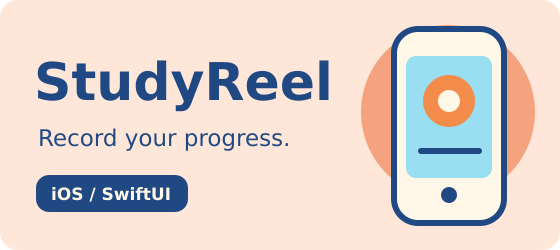
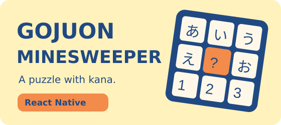
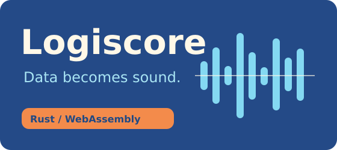
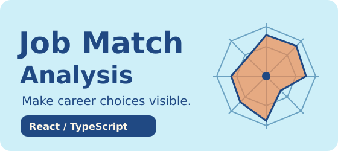
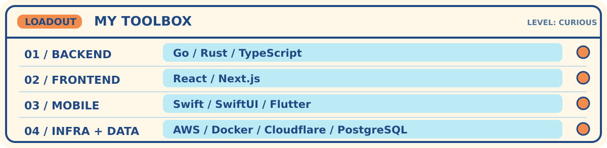

<!-- A playful GitHub profile, with original illustrations rather than app screenshots. -->

  

  <a href="https://enludus.com">🌐 Portfolio</a>
  &nbsp;·&nbsp;
  <a href="https://zenn.dev/ibukinagase">✍️ Zenn</a>
  &nbsp;·&nbsp;
  <a href="https://x.com/enludus">💬 X</a>

### Hey, welcome in! 👋

I'm **Ibuki Nagase**, a software engineer who enjoys both **building dependable systems** and **making playful products**.

My main interests are Go/backend engineering, product design, and the whole journey from **finding a problem → designing → shipping → improving**. This is where I collect the things I've made and the things I'm still figuring out.

## 🕹️ Pick something to explore

<table>
  <tr>
    <td width="50%" valign="top">
      
       <strong>StudyReel</strong> · <code>Swift</code> <code>SwiftUI</code>
       A study companion that records the process of learning, not just elapsed time.
       <a href="https://github.com/naki0227/StudyReel">Source</a> · <a href="https://apps.apple.com/jp/app/studyreel/id6756177589">App Store</a>
    </td>
    <td width="50%" valign="top">
      
       <strong>Gojuon Minesweeper</strong> · <code>React Native</code> <code>Expo</code>
       A word-and-logic game built around the Japanese kana table.
       <a href="https://github.com/naki0227/gojuon-minesweeper">Source</a> · <a href="https://apps.apple.com/jp/app/id6819539119">App Store</a>
    </td>
  </tr>
  <tr>
    <td width="50%" valign="top">
      
       <strong>Logiscore</strong> · <code>Rust</code> <code>WebAssembly</code>
       Turn data into sound, then recover it from a recording — in the browser.
       <a href="https://github.com/naki0227/logiscore">Source</a> · <a href="https://logiscore.enludus.com">Demo</a>
    </td>
    <td width="50%" valign="top">
      
       <strong>Job Match Analysis</strong> · <code>React</code> <code>TypeScript</code>
       Compare career preferences and job information across eight dimensions.
       <a href="https://github.com/naki0227/job-match-analysis">Source</a> · <a href="https://career.enludus.com">Website</a>
    </td>
  </tr>
</table>

<strong>🎒 More from the workshop</strong>

 

- [Nue](https://github.com/naki0227/nue) — video editing with Rust and FFmpeg.
- [EnCura](https://github.com/naki0227/encura) — an AI-powered museum companion.
- [Mirutabi](https://github.com/naki0227/mirutabi) — stories and routes from journeys.
- [site-skills](https://github.com/naki0227/site-skills) — design skills grounded in studying real websites.

## 🎒 What I'm building with

  

I'm particularly interested in **API design**, **data consistency**, **testing**, **security**, and **operability**. The tools change depending on the problem; the reasons for choosing them matter more.

## 📊 Player stats (GitHub edition)

<!-- Public third-party stats may be rate-limited. They summarize public GitHub data, not skill levels. -->

  
  

These are repository-based statistics, not a measure of proficiency. Public hosted cards can temporarily fail or hit rate limits. GitHub's own contribution activity is also visible below this README.

<!-- OPTIONAL: After enabling and verifying the snake workflow, insert its output SVG here. -->

## 🌱 How I like to work

**Find the real problem.** Think through the trade-offs. Build the smallest useful thing. Test the behavior. Keep improving after release.

I enjoy exploring the space between serious engineering and things that are simply fun to make.

  <strong>Thanks for visiting my playground!</strong> ⭐
   
  <a href="https://github.com/naki0227?tab=repositories">Explore all repositories</a>

